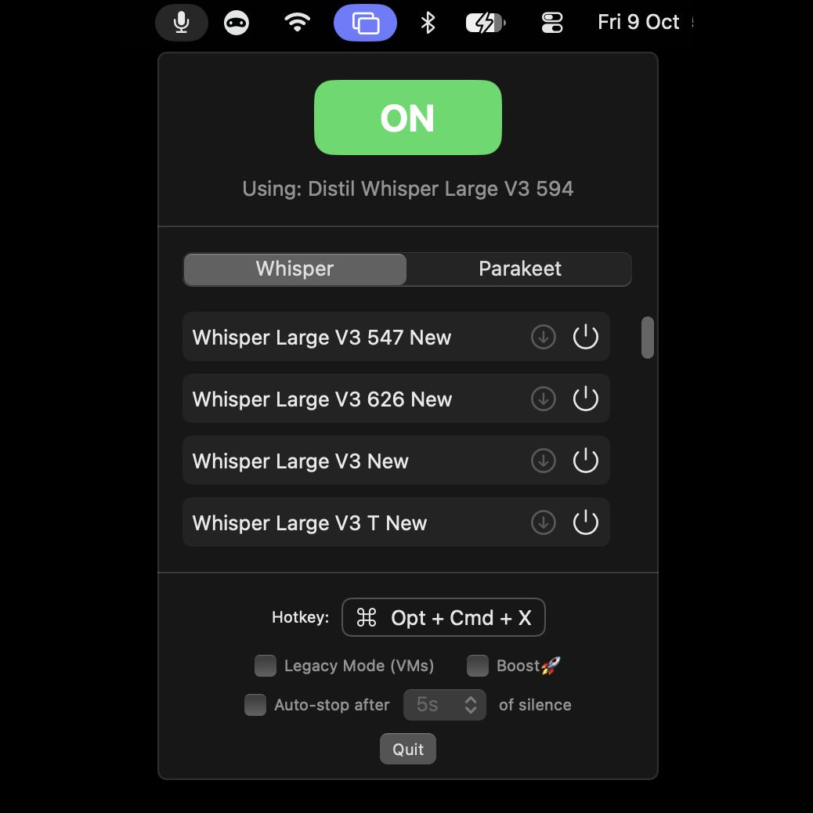
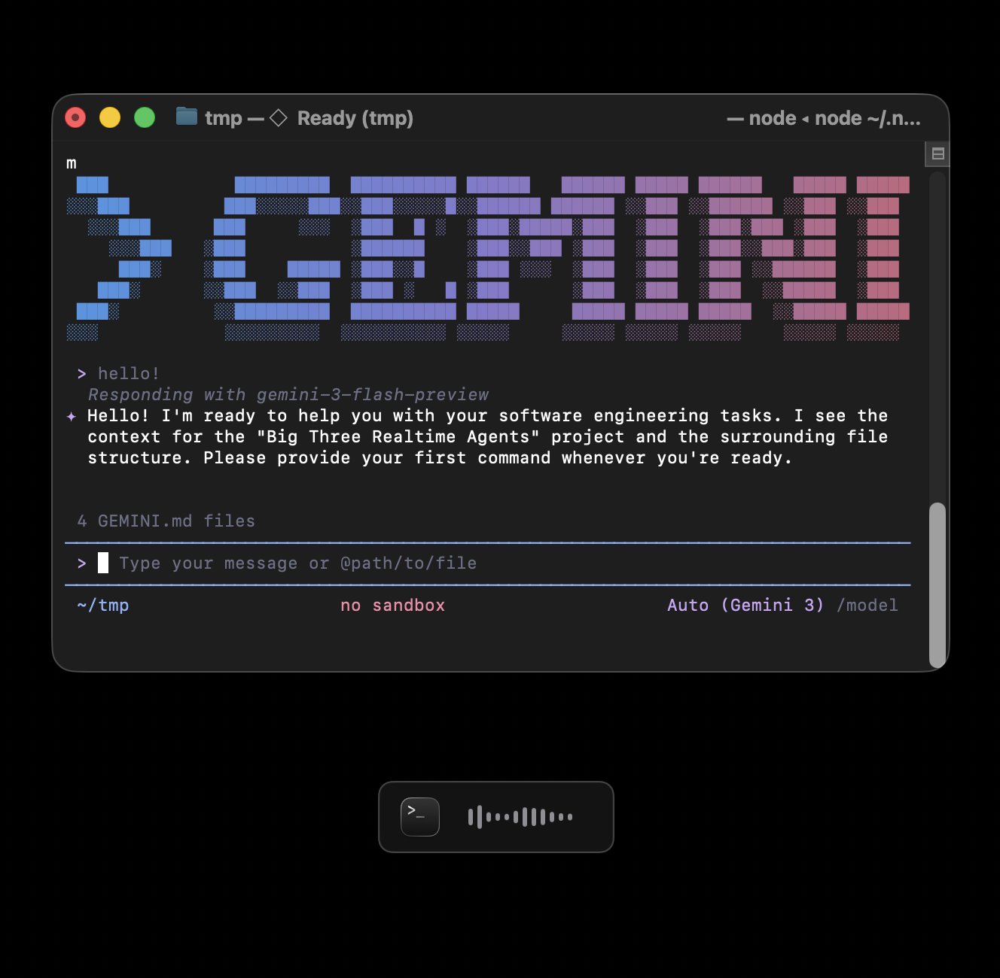

# 🌊 WisprWave

**The Intelligent, Private, Fast Speech-to-Text for macOS.**

**WisprWave** brings OpenAI's powerful **Whisper** models, and NVIDIA's **Parakeet** models, directly to your Mac menu bar. Experience class-leading transcription speed and accuracy without sending a single byte of data to the cloud. It's completely free, works offline, and injects text into *any* application.


<p align="center">
  
  &nbsp; &nbsp;
  
</p>


## Key Features

*   **⚡️ Blazing Fast:** Powered by `WhisperKit` and `FluidAudio`, optimized for Apple Silicon (CoreML). Transcription happens locally and instantly.
*   **🔒 100% Private:** Your voice never leaves your device. Works completely offline—airplane mode approved.
*   **🤖 State-of-the-Art Accuracy:** Supports the latest Whisper Large-v3 models (and smaller variants), plus NVIDIA Parakeet TDT v2 and v3, for nuanced, accurate transcription.
*   **⌨️ Universal Dictation:** Injects text directly into your active application (Notes, Slack, Obsidian, VS Code, etc.).
*   **💻 VM Compatible:** Special legacy mode designed for virtual machines (VMware, Parallels, UTM).


## Performance Modes

WisprWave offers three modes to fit your environment:

### 🚀 Boost Mode
**Maximum Speed.**
For native macOS environments, Boost Mode streams audio in the background and pre-transcribes as you speak using WhisperKit's `clipTimestamps` — each pass only decodes *new* audio past the last confirmed segment, so it never re-processes the same speech twice.
*   **Instant Results:** When you stop speaking, only the final 1–2 seconds need processing. Text appears almost immediately.

### 🎙️ Standard Mode
**Simple & Reliable.**
Records all audio first, then transcribes the full buffer in one pass after you stop recording.
*   **Good For:** Short dictations where the slight delay after stopping is acceptable.
*   **Optimized:** Uses tuned `DecodingOptions` (zero-temperature, prefill cache, no timestamps) for fast single-pass transcription.

### 🐢 Legacy Mode (VM Support)
**Maximum Compatibility.**
Some virtualized environments restrict direct hardware audio access required for streaming.
*   **Dependable:** Records to a temporary file first, then transcribes.
*   **Ideal For:** Use this if you are running macOS inside a VM or experience audio driver issues.


## Choosing a Speech Engine

WisprWave ships two speech engines. **Whisper** is the default; **Parakeet** is opt-in.

*   **Whisper:** The full range of Whisper models, from Tiny to Large-v3, and the only engine that supports Boost Mode.
*   **Parakeet v2 (English):** NVIDIA's Parakeet TDT 0.6B v2, the most accurate choice for English.
*   **Parakeet v3 (25 languages):** Parakeet TDT 0.6B v3, for 25 European languages.

**Switching:** Use the **Whisper | Parakeet** switch at the top of the model list in the menu-bar popup. Switching unloads the current model and loads the last model you used with the other engine, so only one model is ever in memory.

**Downloads:** Each Parakeet model is about 460–480 MB and is stored in `~/Library/Application Support/WisprWave/Models`, alongside your Whisper models. After the download, the first-time preparation takes about 15 seconds; later loads are near-instant.

**Modes:** Boost is Whisper-only and is greyed out under Parakeet. It isn't needed: Parakeet transcribes a whole recording in well under a second (about 0.13 s for 29 s of audio on an M4 Max). Legacy Mode and auto-stop work with both engines.


## Download

Don't want to build from source? Download the latest ready-to-use app:

[**Download WisprWave.zip**](https://github.com/panks/WisprWave/releases/latest)

1.  Download the zip file.
2.  Unzip and drag `WisprWave.app` to your Applications folder.
3.  Follow the launch instructions below.

Recommended Model: *Wisper Large V3 632T New*


## Installation from Source

WisprWave is open-source. Build it directly from the codebase in minutes.

### Prerequisites
*   macOS 14.0+ (Sonoma or later recommended)
*   Xcode 15+ (for Swift 6 support)

### Steps

1.  **Clone the Repository:**
    ```bash
    git clone https://github.com/yourusername/WisprWave.git
    cd WisprWave
    ```

2.  **Build and Package:**
    We've included a helper script to build and sign the app bundle automatically.
    ```bash
    ./package_app.sh
    ```

3.  **Launch:**
    Open the generated app in the project directory:
    ```bash
    open WisprWave.app
    ```

    > **⚠️ Note:** Since this app is not signed with an Apple Developer ID, macOS (Gatekeeper) may block it.
    > *   **System Settings:** Go to *System Settings > Privacy & Security* and click "Open Anyway" near the bottom.
    > *   **Alternative:** Right-click the app in Finder, select *Open*, and confirm in the dialog.

4.  **Permissions:**
    On first launch, grant **Accessibility** (for text injection) and **Microphone** permissions when prompted. The menu bar icon will appear, ready for action!


## Contributing

Contributions are welcome! Feel free to open issues or submit pull requests to make WisprWave even better.


## Credits

*   **Whisper** models by OpenAI, run with [WhisperKit](https://github.com/argmaxinc/WhisperKit).
*   **Parakeet TDT 0.6B v2 / v3** by NVIDIA, with Core ML conversions by FluidInference ([v2](https://huggingface.co/FluidInference/parakeet-tdt-0.6b-v2-coreml), [v3](https://huggingface.co/FluidInference/parakeet-tdt-0.6b-v3-coreml)), licensed CC-BY-4.0.
*   **[FluidAudio](https://github.com/FluidInference/FluidAudio)** (Apache-2.0) runs the Parakeet models on the Neural Engine.


## License

MIT License. Free for everyone. The Parakeet models are licensed separately under CC-BY-4.0 (see Credits).
